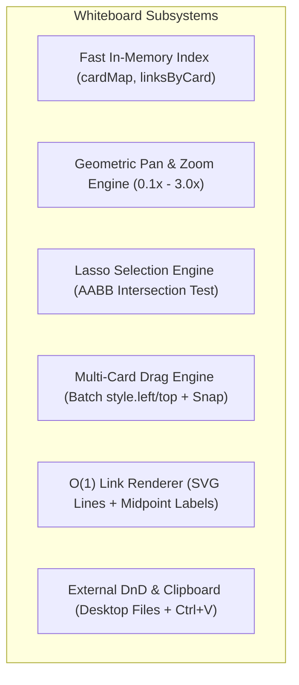
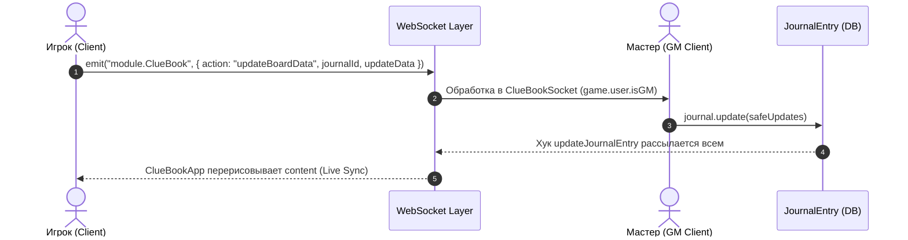
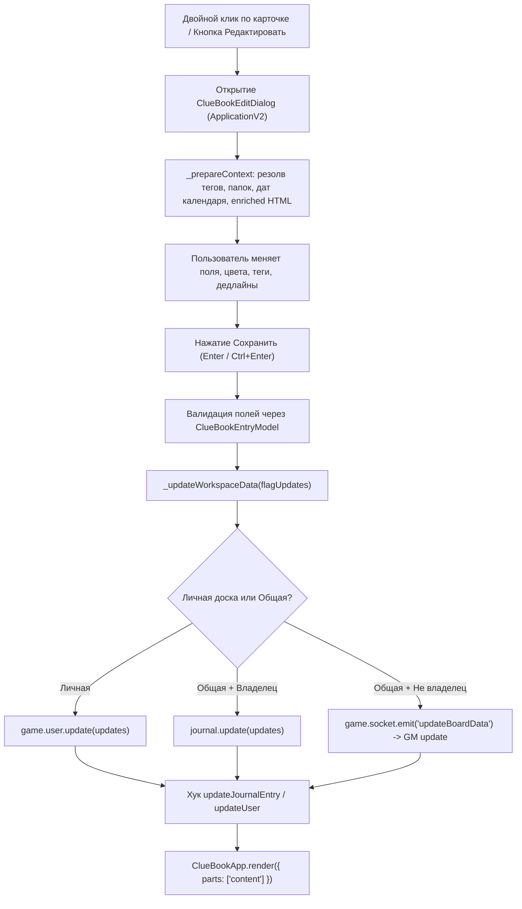

# 🏛️ Архитектурная карта модуля ClueBook (Foundry VTT v14)

Данный документ представляет собой исчерпывающее техническое руководство и карту архитектуры модуля **ClueBook** для разработчиков и автономных ИИ-агентов. Он описывает принципы проектирования, жизненный цикл инициализации, схемы моделей данных, слой представления (ApplicationV2 + Handlebars), сервисы, сокет-протокол, потоки данных и пошаговые инструкции по модификации кодовой базы.

---

## 📑 Содержание
1. [Архитектурные стандарты и принципы](#1-архитектурные-стандарты-и-принципы)
2. [Точки входа и жизненный цикл хуков (Hooks Lifecycle)](#2-точки-входа-и-жизненный-цикл-хуков-hooks-lifecycle)
3. [Модели данных и структуры хранения (Data Layer & Flags)](#3-модели-данных-и-структуры-хранения-data-layer--flags)
4. [Слой представления (UI Layer: ApplicationV2, Templates, CSS)](#4-слой-представления-ui-layer-applicationv2-templates-css)
5. [Движок интерактивной доски (Whiteboard Engine)](#5-движок-интерактивной-доски-whiteboard-engine)
6. [Сервисный слой (Services Layer)](#6-сервисный-слой-services-layer)
7. [Миксины действий и событий (Action Mixins)](#7-миксины-действий-и-событий-action-mixins)
8. [Сетевой слой и синхронизация (Socket Layer)](#8-сетевой-слой-и-синхронизация-socket-layer)
9. [Внешние интеграции и зависимости](#9-внешние-интеграции-и-зависимости)
10. [Сквозные графы потока данных (Data Flow Diagrams)](#10-сквозные-графы-потока-данных-data-flow-diagrams)
11. [Справочник для ИИ и разработчика: «Где что искать и как расширять»](#11-справочник-для-ии-и-разработчика-где-что-искать-и-как-расширять)
12. [Полная карта файлов проекта](#12-полная-карта-файлов-проекта)

---

## 1. Архитектурные стандарты и принципы

Модуль спроектирован строго по стандартам **Foundry VTT v14** с соблюдением принципов **SOLID**, **SoC (Separation of Concerns)**, **KISS** и **DRY**:

1. **Разделение ответственности (SoC):**
   - **Data Layer (`scripts/data-models.js`, `scripts/app-data.js`):** Схемы данных, валидация, миграции, очистка. Ноль обращений к DOM.
   - **UI Layer (`scripts/app.js`, `scripts/edit-dialog.js`, `scripts/tracker.js`, `scripts/tag-manager.js`):** Контекст Handlebars (`_prepareContext`), перехват событий DOM, вызов действий. Ноль бизнес-математики.
   - **Domain Services (`scripts/services/*`):** Независимые модульные сервисы времени, медиа, парсинга текста, трекинга.
   - **Action Mixins (`scripts/actions/*`):** Изолированные обработчики действий пользователя (карточки, папки, доски, интеграции, drag-and-drop).
2. **Строгий v14 API (No Legacy):**
   - Исключительно `foundry.applications.api.ApplicationV2`, `HandlebarsApplicationMixin` и `DialogV2`.
   - Запрещены `FormApplication`, legacy `Application`, jQuery (`$`) и прямые мутации `element.innerHTML` для смены состояния.
   - Обновление интерфейса выполняется через нативный парциальный рендеринг: `this.render({ parts: ["content"] })` или `this.render({ parts: ["tabs", "content"] })`.
3. **Безопасность сериализации (Data-Schema Exception):**
   - Все флаги сохраняются только в сериализованном виде: `model.toObject()`. Сырые экземпляры классов `DataModel` никогда не передаются в `setFlag` или `update()`.
   - Удаление свойств в БД выполняется атомарно через оператор `getForcedDeletion()` (`foundry.data.operators.ForcedDeletion`), исключая баги слияния `null`.
4. **Строгий CSS Scoping:**
   - Все стили изолированы под уникальными корневыми классами (`.cluebook-window`, `.cluebook-widget`, `.cb-tracker-widget`, `.cb-date-picker-dialog`, `.cb-overlay-backdrop`). Запрещены глобальные селекторы (`button`, `input`, `.window-content`).
5. **Позитивная семантика настроек (UX Consistency):**
   - Все тумблеры и переключатели формулируются в утвердительной форме («Отображать...», «Включить...»). Инвертированные флаги (`hide*`) привязываются через `data-invert="true"`.

---

## 2. Точки входа и жизненный цикл хуков (Hooks Lifecycle)

Модуль загружается через `scripts/main.js` (объявлен в [module.json](file:///e:/Program/Foundry/DataGame/Data/modules/ClueBook/module.json)).

```mermaid
graph TD
    A["Hooks.once('init')"] --> B["Регистрация настроек (hideWelcomeMessage112)"]
    A --> C["Регистрация Scene Controls (getSceneControlButtons)"]
    A --> D["Экспорт публичного API (game.modules.get('ClueBook').api)"]
    A --> E["Предзагрузка шаблонов (loadTemplates)"]
    
    F["Hooks.once('ready')"] --> G["Инициализация сокетов (ClueBookSocket.init())"]
    F --> H["Инициализация оверлея (ClueBookOverlay.init())"]
    F --> I["Подписка на игровое время (TimeService.registerHook())"]
    F --> J["Создание и инжекция FAB-виджета (#cluebook-widget)"]
    
    K["Hooks.on('updateUser')"] --> L["Реакция на флаги: trackedEvents, settings, uiMode"]
    M["Hooks.on('updateJournalEntry')"] --> N["Live Sync: синхронизация общих досок"]
```



### 2.1. `Hooks.once("init")` ([scripts/main.js:38-270](file:///e:/Program/Foundry/DataGame/Data/modules/ClueBook/scripts/main.js#L38-L270))
- **`game.settings.register("ClueBook", "hideWelcomeMessage112")`:** Флаг показа приветственного сообщения для GM.
- **`Hooks.on("renderChatMessage")`:** Делегирование клика по кнопке закрытия приветствия.
- **`Hooks.on("getSceneControlButtons")`:** Инжекция группы управления `cluebook` в левую панель сцены Foundry при `theme.uiMode === "controls"`. Предотвращает краш v14 при смене режима через подстановку фиктивного контрола (`dummy`) с автопереключением на `tokens`.
- **`game.modules.get("ClueBook").api`:** Экспорт глобального программного интерфейса:
  ```javascript
  game.modules.get("ClueBook").api = {
    openApp: async ({ workspace, tab, focusId }) => { ... },
    toggleTracker: () => { ... },
    closeTracker: () => { ... },
    TextEnrichmentService,
    UIService
  };
  ```
- **`loadTemplates`:** Предзагрузка ключевых HBS-шаблонов (`tab-settings.hbs`, `tab-workspaces.hbs`, `tab-board.hbs`, `entry-card.hbs`).

### 2.2. `Hooks.once("ready")` ([scripts/main.js:272-520](file:///e:/Program/Foundry/DataGame/Data/modules/ClueBook/scripts/main.js#L272-L520))
- Вызов `ClueBookSocket.init()` и `ClueBookOverlay.init()`.
- Отправка приветственного карточного сообщения в чат ГМу (если не отключено).
- Регистрация слушателя игрового времени через `TimeService.registerHook()`: при изменении минут перерисовывает активное окно `ClueBookApp` и виджет `TrackerWidget`.
- Создание плавающего FAB-виджета (`#cluebook-widget`) с радиальным меню, захватом указателя (`pointerdown/move/up`), защитой от вылета за границы экрана и сохранением координат во флаг `widgetPos`.

### 2.3. Реактивные хуки данных
- **`Hooks.on("updateUser")` ([scripts/main.js:522-588](file:///e:/Program/Foundry/DataGame/Data/modules/ClueBook/scripts/main.js#L522-L588)):**
  Срабатывает при изменении флагов текущего пользователя. Реагирует на:
  - `flags.ClueBook.trackedEvents` — перерисовка трекера и карточек.
  - `flags.ClueBook.settings.theme.uiMode` — переключение между FAB и Scene Controls.
  - `flags.ClueBook.settings.widget` — динамическое перестроение кнопок FAB без перезагрузки страницы.
- **`Hooks.on("updateJournalEntry")` ([scripts/main.js:591-622](file:///e:/Program/Foundry/DataGame/Data/modules/ClueBook/scripts/main.js#L591-L622)):**
  Обеспечивает синхронизацию в реальном времени (Live Sync). Если обновлена активная общая доска:
  - Проверяет `document.activeElement` (не прерывает ввод текста в `input`, `textarea`, `select`).
  - Проверяет `state.isBoardInteracting` (если пользователь перемещает карточки/камеру, выставляет `pendingRender = true` и откладывает рендер до окончания взаимодействия).

---

## 3. Модели данных и структуры хранения (Data Layer & Flags)

Схемы объявлены в [scripts/data-models.js](file:///e:/Program/Foundry/DataGame/Data/modules/ClueBook/scripts/data-models.js) с использованием типов `foundry.data.fields`.

### 3.1. `ClueBookEntryModel` (Карточка/Сущность)

| Поле | Тип поля (`foundry.data.fields`) | Дефолт | Назначение |
|---|---|---|---|
| `type` | `StringField` | `"notes"` | Категория: `"notes"`, `"npc"`, `"locations"`, `"quests"`, `"timeline"`, `"gallery"`, `"labels"`, `"pins"`. |
| `color` | `StringField` | `"yellow"` | Имя пресета цвета (`"yellow"`, `"green"`, `"blue"`, `"red"`, `"purple"`, `"orange"`, `"teal"`, `"pink"`, `"brown"`) или hex-код. |
| `textColor` | `StringField` | `"dark"` | Цвет текста карточки (`"dark"` / `"light"`). |
| `tags` | `ArrayField(StringField)` | `[]` | Массив ID присвоенных тегов. |
| `sort` | `NumberField` | `0` | Порядковый индекс ручной сортировки или timestamp добавления. |
| `pinned` | `BooleanField` | `false` | Закрепление карточки (вверху списка или блокировка перемещения на доске). |
| `folderId` | `StringField` | `""` | ID папки, в которой лежит карточка (пустая строка — корень). |
| `onBoard` | `BooleanField` | `false` | Флаг размещения карточки на интерактивной доске. |
| `boardX`, `boardY` | `NumberField` | `100`, `100` | Абсолютные координаты карточки на холсте доски (в виртуальных пикселях). |
| `boardW`, `boardH` | `NumberField` | `null`, `null` | Индивидуальный размер карточки (при ручном ресайзе). |
| `isHidden` | `BooleanField` | `false` | Скрытие карточки от игроков (режим тайны мастера). |
| `visibleTo` | `ArrayField(StringField)` | `[]` | Выборочная видимость для конкретных пользователей. |
| `text` | `HTMLField` | `""` | Текст заметки (Notes) или формулировка квеста (Quests). |
| `name` | `StringField` | `""` | Имя NPC, название локации, заголовок фото или пина. |
| `location` | `StringField` | `""` | Местонахождение NPC. |
| `attitude` | `StringField` | `""` | Отношение NPC к партии (союзник, враг, нейтрал). |
| `note` | `HTMLField` | `""` | Подробное описание NPC, локации или пина. |
| `actorUuid` | `StringField` | `""` | UUID связанного документа `Actor` в Foundry. |
| `lifeStatus` | `StringField` | `""` | Статус жизни NPC (`"alive"`, `"dead"`, `"unknown"`). |
| `isDead` | `BooleanField` | `false` | Обратная совместимость статуса мертвого NPC. |
| `status` | `StringField` | `"active"` | Статус квеста (`"active"`, `"completed"`, `"failed"`). |
| `deadline` | `StringField` | `""` | Текстовый дедлайн квеста. |
| `deadlineTimestamp`| `NumberField` | `null` | Точный timestamp срока квеста по календарю мира. |
| `completedTime` | `StringField` | `""` | Дата/время фактического завершения квеста. |
| `time` | `StringField` | `""` | Текстовое время события хронологии (Timeline). |
| `event` | `HTMLField` | `""` | Текст события хронологии. |
| `subtitle` | `HTMLField` | `""` | Подзаголовок / тип локации (напр., «Таверна», «Руины»). |
| `sceneUuid` | `StringField` | `""` | UUID связанного документа `Scene` в Foundry. |
| `owner` | `StringField` | `""` | Владелец / правитель локации. |
| `gmNotes` | `HTMLField` | `""` | Секретные заметки мастера (видны только ГМу). |
| `img` | `StringField` | `""` | Путь к изображению (Галерея / Полароид). |
| `caption` | `StringField` | `""` | Подпись под фотокарточкой. |
| `frameStyle` | `StringField` | `"polaroid"` | Стиль рамки (`"polaroid"` с полями или `"frameless"` без полей). |
| `cropMode` | `StringField` | `"contain"` | Режим кадрирования фото (`"contain"` / `"cover"`). |
| `cropPosition` | `StringField` | `"center"` | Выравнивание фото (`"top"`, `"center"`, `"bottom"`). |
| `rotation` | `NumberField` | `0` | Случайный угол наклона полароида (-4.0° ... +4.0°). |
| `fontSize` | `NumberField` | `28` | Размер шрифта текстовой надписи (Labels) на доске. |
| `fontFamily` | `StringField` | `"caveat"` | Шрифт надписи (`"caveat"`, `"inter"`, `"courier"`, `"cinzel"`). |
| `bgStyle` | `StringField` | `"glass"` | Фон надписи/пина (`"glass"`, `"transparent"`, `"solid"`). |
| `icon` | `StringField` | `"fa-thumbtack"`| Иконка булавки/пина (FontAwesome класс). |
| `timeMode` | `StringField` | `"by"` | Режим дедлайна: `"by"` (к сроку) или `"at"` (строго в указанное время). |
| `isTracked` | `BooleanField` | `false` | Помещен ли квест в плавающий трекер задач. |

### 3.2. `ClueBookLinkModel` (Нить связи на доске)
- `source` (`StringField`, required): ID исходной карточки.
- `target` (`StringField`, required): ID целевой карточки.
- `label` (`StringField`): Текстовая подпись на нити (напр., «Подозревает», «Владеет», «Предал»).
- `style` (`StringField`, default: `"solid"`): Стиль линии (`"solid"`, `"dashed"`, `"dotted"`).
- `color` (`StringField`): Индивидуальный цвет нити (hex) или пустая строка (дефолтный цвет).
- **Ключ хранения:** В словаре `links` ключ всегда нормализуется по алфавиту: `${min(source, target)}_${max(source, target)}` для предотвращения дубликатов связей.

### 3.3. `ClueBookFolderModel` (Папка / Секция)
- `name` (`StringField`, required): Название папки.
- `tab` (`StringField`, required): Вкладка, к которой привязана папка.
- `color` (`StringField`, default: `"purple"`): Цветовой акцент папки.
- `position` (`StringField`, default: `"top"`): Размещение относительно корня (`"top"` — над карточками корня, `"bottom"` — под карточками корня).
- `sort` (`NumberField`, default: `0`): Порядок папки.
- `isCollapsed` (`BooleanField`, default: `false`): Свернута/развернута.

### 3.4. Структура хранения во флагах документов
#### А. Личное пространство (Personal Workspace)
Сохраняется во флагах документа `User` (`game.user`):
- `flags.ClueBook.data`: словарь карточек по категориям (`notes`, `npc`, `locations`, `quests`, `timeline`, `gallery`, `labels`, `pins`), папок (`folders`) и связей (`links`).
- `flags.ClueBook.settings`: настройки пользователя (тема, акцентные цвета, скрытые вкладки, виджет, теги `tags`).
- `flags.ClueBook.trackedEvents`: массив ID отслеживаемых квестов и событий для виджета `TrackerWidget`.
- `flags.ClueBook.favoriteWorkspaces`: массив ID избранных досок для закрепления чипов в шапке окна (`.cb-header-boards`).
- `flags.ClueBook.boardCameras`: объект камер `{ [workspaceId]: { zoom, panX, panY } }`.
- `flags.ClueBook.widgetPos`: координаты FAB `{ left, top, bottom }`.
- `flags.ClueBook.trackerWidgetPos`: координаты трекера `{ left, top }`.
- `flags.ClueBook.lastTab`, `flags.ClueBook.lastWorkspace`: состояние последней открытой вкладки и доски.
- `flags.ClueBook.tabSortModes`, `flags.ClueBook.tabViewModes`: режимы сортировки и вида карточек (grid / list / compact).

#### Б. Общие доски (Shared Workspaces)
Каждая общая доска — это документ `JournalEntry` в папке `"ClueBook Boards"`:
- `flags.ClueBook.isWorkspace: true` — маркер того, что журнал является доской ClueBook.
- `flags.ClueBook.data`: объект данных доски (`notes`, `npc`, `locations`, `quests`, `timeline`, `gallery`, `labels`, `pins`, `folders`, `links`).
- `flags.ClueBook.settings`: индивидуальные настройки конкретной доски (права `readOnly`, скрытые вкладки `hiddenTabs`, скрытые кнопки карточек `hideBtn*`, локальные теги `tags`).
- `ownership`: стандартная матрица прав Foundry (управляет доступом игроков к чтению/редактированию доски).

---

## 4. Слой представления (UI Layer: ApplicationV2, Templates, CSS)

### 4.1. Архитектура наследования `ClueBookApp`
Главный класс приложения [scripts/app.js](file:///e:/Program/Foundry/DataGame/Data/modules/ClueBook/scripts/app.js) формируется через конвейер миксинов:

```javascript
const BaseApp = ClueBookFolderActionsMixin(
  ClueBookDragDropMixin(
    ClueBookEntryActionsMixin(
      ClueBookWorkspaceActionsMixin(
        ClueBookIntegrationActionsMixin(
          ClueBookBoardActionsMixin(
            ClueBookBoardMixin(
              ClueBookDataMixin(
                HandlebarsApplicationMixin(ApplicationV2)
              )
            )
          )
        )
      )
    )
  )
);
export class ClueBookApp extends BaseApp { ... }
```

### 4.2. Маппинг UI-классов, HBS-шаблонов и CSS

```
templates/
├── content.hbs                  ──> Главное тело приложения (.cluebook-content)
├── tabs.hbs                     ──> Навигационная панель вкладок (.cluebook-tabs)
├── edit-dialog.hbs              ──> Модальный редактор карточки (.cb-edit-dialog)
├── date-fields.hbs              ──> Парциал полей даты внутри редактора
├── date-picker.hbs              ──> Календарный диалог выбора времени (.cb-date-picker-dialog)
├── tag-manager.hbs              ──> Окно менеджера тегов (.cb-tag-manager)
├── tracker-widget.hbs           ──> Плавающий трекер активных задач (.cb-tracker-widget)
└── partials/
    ├── entry-card.hbs           ──> Универсальный рендер карточки (grid / list / compact / board)
    ├── tab-board.hbs            ──> Холст доски, SVG контейнер связей и контролы
    ├── tab-settings.hbs         ──> Настройки окна, FAB, трекера, интеграций
    └── tab-workspaces.hbs       ──> Управление личными и общими досками
```

### 4.3. Состояние приложения (`ClueBookApp.prototype.state`)
```javascript
state = {
  activeTab: "notes",               // Текущая вкладка (search, notes, npc, locations, quests, timeline, gallery, board, workspaces, settings)
  activeWorkspace: "personal",      // ID активной доски ("personal", "personal_USERID", или ID JournalEntry)
  searchQuery: "",                  // Строка полнотекстового поиска
  editingEntryId: null,             // ID карточки в режиме инлайн-редактирования
  highlightedEntryId: null,         // ID временно подсвеченной карточки
  selectedEntryId: null,            // Одиночное выделение
  selectedEntries: new Set(),       // Множество ID карточек для массовых операций и группового drag
  searchTags: [],                   // Активные теги фильтрации в поиске
  searchCategoryFilter: "all",      // Фильтр категории поиска ("all", "npc", "locations", "notes", "quests", "timeline", "gallery", "pins")
  questFilter: "all",               // Фильтр квестов: "all", "active", "completed", "failed"
  npcFilter: "all",                 // Фильтр NPC: "all", "alive", "dead", "unknown"
  questSortMode: "chronological",   // Режим сортировки квестов ("chronological", "chronological_desc", "manual")
  timelineSortMode: "chronological",// Режим сортировки хронологии
  tabViewModes: {},                 // Вид отображения per-tab ("grid", "list", "compact")
  camera: { zoom: 1, panX: 0, panY: 0 }, // Камера текущей доски
  isBoardInteracting: false,        // Флаг активного перетаскивания/зума на доске
  pendingRender: false,             // Отложенный рендер при входящем WebSocket обновлении
  isZenMode: false                  // Полноэкранный режим без рамок
};
```

---

## 5. Движок интерактивной доски (Whiteboard Engine)

Реализован в [scripts/app-board.js](file:///e:/Program/Foundry/DataGame/Data/modules/ClueBook/scripts/app-board.js) (`ClueBookBoardMixin`).



### 5.1. In-Memory Index & Zero-Reflow Rendering
При открытии доски один раз строится пространственный индекс:
- `cardMap: Map<cardId, { id, el, tab, x, y, w, h, isPinned }>` — координаты и размеры всех карточек.
- `linksByCard: Map<cardId, Set<LinkRecord>>` — граф смежности связей.
- `updateLinesForCards(movingCardIds)` — обновляет атрибуты `x1, y1, x2, y2` **только** для нитей, соединенных с перемещаемыми карточками, без единого `getBoundingClientRect()` во время анимации.

### 5.2. Прямоугольное выделение (Lasso Selection)
- Зажатие ЛКМ на пустом месте холста активирует рамку лассо (`cb-lasso-box`).
- В цикле `mousemove` через `requestAnimationFrame` выполняется быстрый AABB-тест пересечения:
  ```javascript
  if (card.x < right && card.x + card.w > left && card.y < bottom && card.y + card.h > top) {
    selectedEntries.add(card.id);
  }
  ```
- Зажатый `Shift` или `Ctrl` инкрементирует выделение без сброса предыдущего.

### 5.3. Создание связей (Interactive Linking)
1. **Клик по кнопке связи (`.btn-link`):** Переводит карточку в режим источника (`linking-source`). Клик по второй карточке мгновенно создает связь `_createLink(sourceId, targetId)`.
2. **Перетаскивание нити:** Зажатие ЛКМ на `.btn-link` тянет временную SVG-линию (`tempLine`) к курсору. При отпускании мыши над целевой карточкой связь фиксируется.
3. **Двойной клик по нити или метке:** Открывает диалог настройки цвета, стиля (solid, dashed, dotted) и текста подписи связи (`_editConnectionSettings`).

### 5.4. Центрирование доски (`recenterBoard`)
Вычисляет охватывающий прямоугольник (Bounding Box) всех существующих карточек:
```javascript
const contentW = (maxX - minX) + 160;
const contentH = (maxY - minY) + 160;
let newZoom = Math.min(1.2, Math.max(0.15, Math.min(boardW / contentW, boardH / contentH)));
```
Плавно центрирует камеру и сохраняет координаты во флаг `boardCameras[workspaceId]`.

### 5.5. Буфер обмена (`Ctrl+V`) и Desktop Drop
- Нажатие `Ctrl+V` на доске перехватывает изображение из буфера обмена, загружает через `MediaService` и создает карточку-полароид прямо под текущими координатами курсора мыши.
- Дроп файлов изображений с рабочего стола выполняет пакетное создание полароидов веером (`_createQuickMediaBatch`).
- Угол наклона каждой фотокарточки рассчитывается через балансировочный генератор `getRandomPhotoTilt()`, если в настройках не включено `features.disablePhotoTilt`.

### 5.6. Контекстное меню холста и карточек (`_showBoardContextMenu`)
- **Одиночная карточка:** Быстрое редактирование (`edit`), закрепление/открепление (`toggle-pin`), переключение наклона (`toggle-rotation` — выравнивание `rotate: 0deg` или случайный наклон полароида), видимость для игроков (`toggle-visibility`), отправка в оверлей (`share-overlay`), открытие чарника актера (`open-actor`), переход к сцене (`activate-scene`), удаление с доски (`remove-board`) или полное удаление (`delete`).
- **Группа карточек (>1):** Выравнивание (по левому краю, по центру, по правому краю), вертикальное распределение с равным шагом, групповое выравнивание наклона (`reset-rotation-group`), групповое закрепление/открепление, массовое удаление с доски.

### 5.7. Навигация по ссылкам и упоминаниям (`_navigateToEntryTab`)
- Клик по упоминанию `[[qnmention:...]]`, плашке связи карточки или ссылке внутри поповера маркера переключает пользователя на соответствующую вкладку сущности (NPC, Локации, Заметки, Квесты, Галерея, Хронология), плавно скроллит к ней и подсвечивает карточку неоновым сиянием.

### 5.8. Переход на доску к карточке (`_onJumpToBoard`)
- Кнопка «Найти на доске» (`.btn-jump`) на карточке в любой вкладке мгновенно переключает приложение на вкладку доски (`activeTab = "board"`), обновляет индикатор активной вкладки, центрирует виртуальную камеру точно на целевой карточке и подсвечивает ее неоновым сиянием.

---

## 6. Сервисный слой (Services Layer)

Сервисы расположены в [scripts/services/](file:///e:/Program/Foundry/DataGame/Data/modules/ClueBook/scripts/services/) и полностью изолированы от прямого взаимодействия с базой данных:

### 6.1. `TimeService` ([scripts/services/time-service.js](file:///e:/Program/Foundry/DataGame/Data/modules/ClueBook/scripts/services/time-service.js))
- Провайдеры: `"simple-calendar"` (Simple Calendar), `"calendaria"` (Calendaria), `"native"` (стандартный WorldTime Foundry).
- `getCurrentDateTime()`: возвращает `{ timestamp, date, time, weekday, fullStr }`.
- `formatTimestamp(ts)`: конвертирует timestamp в локализованную дату и время.
- `dateToTimestamp(dateObj)` / `timestampToDate(ts)`: нормализует различия индексов месяцев (0-indexed vs 1-indexed).
- `addNote(title, content, timestamp)`: создает заметку в активном календаре.
- `changeTime(minutes)`: перематывает время мира.
- `getWeather()`: получает погоду и температуру от Calendaria или локальных настроек.

### 6.2. `MediaService` ([scripts/services/media-service.js](file:///e:/Program/Foundry/DataGame/Data/modules/ClueBook/scripts/services/media-service.js))
- Каталог хранения: `worlds/${game.world.id}/cluebook-gallery`.
- `uploadFile(file)` / `uploadFiles(files)`: проверка прав ГМа и загрузка через `FilePicker.upload`.
- `#uploadViaSocket(file)`: если игрок не имеет прав на запись файлов в Foundry, файл конвертируется в Base64 и отправляется ГМу через сокет `uploadMedia`. ГМ сохраняет файл и возвращает путь через `mediaUploadComplete`.

### 6.3. `TextEnrichmentService` ([scripts/services/text-enrichment-service.js](file:///e:/Program/Foundry/DataGame/Data/modules/ClueBook/scripts/services/text-enrichment-service.js))
- Регулярные выражения: `MENTION_REGEX` (`[[qnmention:ID:Name]]{CustomText}`), `BARE_UUID_REGEX` (автоматическое оборачивание «голых» UUID актеров/сцен в `@UUID[...]`).
- `enrichMentionsToHTML(text)`: конвертирует меншны в интерактивные ссылки `<a class="content-link cb-mention-link" data-mention-id="...">`.
- `stripToPlainText(str)`: глубокая очистка текста от HTML-тегов, секретов ГМа `<section class="secret">`, меншнов и HTML-сущностей для компактных сниппетов.
- `extractDisplayAndSnippet(name, noteText)`: асинхронное извлечение и обогащение заголовка и краткого описания через `TextEditor.enrichHTML` с поддержкой `@UUID[...]` и `[[qnmention:...]]`, очисткой блочных тегов `<p>` для однострочных и двухстрочных представлений (таблица/список).
- `bindMentionClicks(container, onJump)`: делегирование кликов по меншнам и контент-ссылкам с плавным переходом к целевой карточке или открытием документа Foundry.

### 6.4. `TrackerService` ([scripts/services/tracker-service.js](file:///e:/Program/Foundry/DataGame/Data/modules/ClueBook/scripts/services/tracker-service.js))
- `getTrackedEvents(trackedIds, showOverdue)`: асинхронно опрашивает личное пространство, все доступные общие журналы досок и личные доски других игроков (для ГМа).
- Извлекает активные квесты и события хронологии, вычисляет дельту времени `diff = targetTs - currentTs`, статус `isOverdue` и строку обратного отсчета (`"2д 4ч 15м"`).

### 6.5. `UIService` ([scripts/services/ui-service.js](file:///e:/Program/Foundry/DataGame/Data/modules/ClueBook/scripts/services/ui-service.js))
- `showFloatingMenu({ target, items, currentId, onSelect, minWidth })`: отображение плавающего выпадающего меню (статусы квестов, режимы сортировки, режимы вида) с привязкой к кнопке, контролем выхода за границы экрана и автозакрытием по клику вне меню.
- `hexToRgb(hex)` / `hexToRgba(hex, alpha)`: утилиты цветовой палитры.

---

## 7. Миксины действий и событий (Action Mixins)

Миксины действий вынесены в папку [scripts/actions/](file:///e:/Program/Foundry/DataGame/Data/modules/ClueBook/scripts/actions/):

| Файл миксина | Название класса-миксина | Ключевые методы |
|---|---|---|
| [entry-actions.js](file:///e:/Program/Foundry/DataGame/Data/modules/ClueBook/scripts/actions/entry-actions.js) | `ClueBookEntryActionsMixin` | `_onAddEntry`, `_onToggleEdit`, `_onDeleteEntry`, `_onTogglePin`, `_onToggleTrack`, `_onToggleVisibility`, `_onToggleQuestStatusMenu`, `_onSetQuestStatus`, `_onToggleSortMenu`, `_onToggleViewMenu`, `_onManageTags`, `_onToggleZenMode`. |
| [board-actions.js](file:///e:/Program/Foundry/DataGame/Data/modules/ClueBook/scripts/actions/board-actions.js) | `ClueBookBoardActionsMixin` | `_onJumpToBoard`, `_onJumpToLinked`, `_onJumpToTab`, `_onDeleteLink`, `_onRecenterBoard`, `_onSendToBoard`, `_onRemoveFromBoard`. |
| [workspace-actions.js](file:///e:/Program/Foundry/DataGame/Data/modules/ClueBook/scripts/actions/workspace-actions.js) | `ClueBookWorkspaceActionsMixin` | `_onSwitchWorkspace`, `_onCreateSharedWorkspace`, `_onEditWorkspace` (неблокирующее мгновенное сохранение), `_onDeleteWorkspace`, `_onExportJSON`, `_onImportJSON`, `_onCopyDataFormat`. |
| [folder-actions.js](file:///e:/Program/Foundry/DataGame/Data/modules/ClueBook/scripts/actions/folder-actions.js) | `ClueBookFolderActionsMixin` | `_onCreateFolder`, `_onEditFolder`, `_onToggleFolderPosition`, `_onDeleteFolder`, `_onToggleFolderCollapse`, `_onAddEntryToFolder`, `_onSendFolderToBoard`. |
| [integration-actions.js](file:///e:/Program/Foundry/DataGame/Data/modules/ClueBook/scripts/actions/integration-actions.js) | `ClueBookIntegrationActionsMixin` | `_onShareOverlay` (трансляция в 3D оверлей), `_onViewImage` (Lightbox галереи), `_onActivateScene`, `_onOpenActor` (интеграция с Ginzzu Portraits), `_onUploadBatchGallery`. |
| [app-dragdrop.js](file:///e:/Program/Foundry/DataGame/Data/modules/ClueBook/scripts/actions/app-dragdrop.js) | `ClueBookDragDropMixin` | `_setupListDragDrop` (сортировка карточек, перетаскивание между папками и корнем, сортировка папок), `_createQuickMediaBatch`, `_setupClipboardPaste` (вставка скриншотов). |

---

## 8. Сетевой слой и синхронизация (Socket Layer)

Реализован в [scripts/socket.js](file:///e:/Program/Foundry/DataGame/Data/modules/ClueBook/scripts/socket.js) через канал `game.socket.on("module.ClueBook")`.



### Спецификация пакетов:
1. `updateBoardData`: передает `journalId` и `updateData`. ГМ валидирует ключи (`flags.ClueBook.data.*`, `flags.ClueBook.settings.*`), заменяет объекты удаления на `getForcedDeletion()` и выполняет запись в `JournalEntry`.
2. `createBoard`: игрок запрашивает создание общей доски. ГМ создает журнал в папке `"ClueBook Boards"`, настраивает права доступа и отправляет игроку пакет `boardCreated`.
3. `uploadMedia`: передача Base64 файла от игрока ГМу для сохранения в каталог мира. ГМ возвращает `mediaUploadComplete` с путем к файлу.
4. `addSimpleCalendarNote`: проксирование создания заметки в Simple Calendar от имени ГМа с оповещением `scNoteCreated`.
5. `showOverlay`: широковещательная трансляция карточки в 3D оверлей [scripts/overlay.js](file:///e:/Program/Foundry/DataGame/Data/modules/ClueBook/scripts/overlay.js). Карточка появляется на экранах игроков с возможностью скопировать себе в один клик.

---

## 9. Внешние интеграции и зависимости

1. **Simple Calendar (`simple-calendar`):**
   - Получение текущего игрового времени, даты, названия месяцев и дней недели.
   - Подписка на хук изменения времени `SimpleCalendar.Hooks.DateTimeChange`.
   - Создание календарных заметок из квестов и событий хронологии.
2. **Calendaria (`calendaria`):**
   - Альтернативный провайдер календаря и времени.
   - Получение динамической погоды и температуры (`getCurrentWeather`, `getTemperature`).
3. **Ginzzu Portraits (`ginzzzu-portraits`):**
   - Интеграция с портретами актеров через `window.GinzzzuPortraits.togglePortrait(actor)` в карточках NPC.
4. **Foundry Core Documents:**
   - Прямой Drag & Drop документов `Actor`, `Scene`, `Item` на карточки и на доску с автоизвлечением имен, изображений и UUID-ссылок.

---

## 10. Сквозные графы потока данных (Data Flow Diagrams)

### 10.1. Жизненный цикл изменения карточки в редакторе



---

## 11. Справочник для ИИ и разработчика: «Где что искать и как расширять»

### 📍 Быстрый навигатор по кодовой базе:

| Задача | Где искать / Что менять |
|---|---|
| **Добавить новое поле в карточку** | 1. Добавить поле в `ClueBookEntryModel` ([scripts/data-models.js](file:///e:/Program/Foundry/DataGame/Data/modules/ClueBook/scripts/data-models.js)).<br>2. Добавить дефолтное значение в `_getEmptyEntryForTab` ([scripts/app-data.js](file:///e:/Program/Foundry/DataGame/Data/modules/ClueBook/scripts/app-data.js)).<br>3. Добавить HTML-поле в форму [templates/edit-dialog.hbs](file:///e:/Program/Foundry/DataGame/Data/modules/ClueBook/templates/edit-dialog.hbs).<br>4. Отрендерить в [templates/partials/entry-card.hbs](file:///e:/Program/Foundry/DataGame/Data/modules/ClueBook/templates/partials/entry-card.hbs).<br>5. Добавить ключи локализации в `lang/en.json`, `lang/ru.json`. |
| **Добавить новую вкладку (Tab)** | 1. Добавить ID таба в массив `tabs` в `ClueBookApp._prepareTabsContext` ([scripts/app.js](file:///e:/Program/Foundry/DataGame/Data/modules/ClueBook/scripts/app.js)).<br>2. Добавить шаблон отображения в [templates/content.hbs](file:///e:/Program/Foundry/DataGame/Data/modules/ClueBook/templates/content.hbs).<br>3. Добавить кнопку в FAB `buildMenu` ([scripts/main.js](file:///e:/Program/Foundry/DataGame/Data/modules/ClueBook/scripts/main.js)).<br>4. Добавить дефолтные цвета в `DEFAULT_SETTINGS` ([scripts/app.js](file:///e:/Program/Foundry/DataGame/Data/modules/ClueBook/scripts/app.js)). |
| **Изменить логику работы доски или нитей** | Искать в `ClueBookBoardMixin` ([scripts/app-board.js](file:///e:/Program/Foundry/DataGame/Data/modules/ClueBook/scripts/app-board.js)) и `ClueBookBoardActionsMixin` ([scripts/actions/board-actions.js](file:///e:/Program/Foundry/DataGame/Data/modules/ClueBook/scripts/actions/board-actions.js)). Стили: [styles/board.css](file:///e:/Program/Foundry/DataGame/Data/modules/ClueBook/styles/board.css). |
| **Изменить логику папок/секций** | Искать в `ClueBookFolderModel` ([scripts/data-models.js](file:///e:/Program/Foundry/DataGame/Data/modules/ClueBook/scripts/data-models.js)) и `ClueBookFolderActionsMixin` ([scripts/actions/folder-actions.js](file:///e:/Program/Foundry/DataGame/Data/modules/ClueBook/scripts/actions/folder-actions.js)). |
| **Добавить новый сокет-пакет** | 1. Зарегистрировать действие в `ClueBookSocket.init` ([scripts/socket.js](file:///e:/Program/Foundry/DataGame/Data/modules/ClueBook/scripts/socket.js)).<br>2. Реализовать приватный статический метод-обработчик `#handle...`.<br>3. Отправлять через `game.socket.emit("module.ClueBook", { action: "...", ... })`. |
| **Изменить настройки доски или общие настройки** | Настройки доски формируются в `_onEditWorkspace` ([scripts/actions/workspace-actions.js](file:///e:/Program/Foundry/DataGame/Data/modules/ClueBook/scripts/actions/workspace-actions.js)). Общие настройки рендерятся из [templates/partials/tab-settings.hbs](file:///e:/Program/Foundry/DataGame/Data/modules/ClueBook/templates/partials/tab-settings.hbs). |

### ⚠️ Критические правила разработки (Gotchas):
1. **Никогда не вкладывайте `<form>` внутрь `DialogV2.content`:** `DialogV2` уже содержит корневой `<form class="standard-form">`. Вложенные формы ломают DOM Chromium, скроллбары и вычисление высоты flexbox. Используйте `<div>` для контейнеров внутри `DialogV2`.
2. **Всегда используйте `dialog.close({ animate: false })` перед асинхронными сохранениями в диалогах:** Это предотвращает задержки и зависание модальных окон при записи в базу данных.
3. **Всегда используйте `model.toObject()`:** При сохранении моделей данных во флаги Foundry всегда вызывайте `.toObject()`, иначе WebSocket сериализатор выбросит исключение.
4. **Соблюдайте алфавитную сортировку ключей локализации:** Все ключи в `lang/en.json` и `lang/ru.json` должны поддерживаться в актуальном состоянии без пропущенных переводов.

---

## 12. Полная карта файлов проекта

```
ClueBook/
├── module.json                      # Манифест модуля (v14 compatibility, styles, esmodules)
├── ARCHITECTURE.md                  # Данная архитектурная карта
├── CHANGELOG_EN.md                  # История изменений модуля
├── lang/                            # Локализация
│   ├── en.json                      # Английский язык (основной)
│   ├── ru.json                      # Русский язык
│   ├── de.json                      # Немецкий язык
│   └── fr.json                      # Французский язык
├── templates/                       # Handlebars-шаблоны ApplicationV2
│   ├── content.hbs                  # Корневой контейнер содержимого вкладок
│   ├── tabs.hbs                     # Панель переключения вкладок
│   ├── edit-dialog.hbs              # Модальное окно редактирования карточки
│   ├── date-fields.hbs              # Парциал ввода календарной даты
│   ├── date-picker.hbs              # Модальный календарный пикер даты
│   ├── tag-manager.hbs              # Окно управления тегами
│   ├── tracker-widget.hbs           # Плавающий трекер активных задач
│   └── partials/                    # Зарегистрированные HBS Partials
│       ├── entry-card.hbs           # Карточка сущности (все варианты отображения)
│       ├── tab-board.hbs            # Холст интерактивной доски и SVG-нитей
│       ├── tab-settings.hbs         # Вкладка общих настроек модуля
│       └── tab-workspaces.hbs       # Вкладка менеджера личных и общих досок
├── styles/                          # CSS подсистемы
│   ├── core.css                     # Переменные темы, скроллбары, модальные окна, оверлей
│   ├── cards.css                    # Сетка карточек, стили списков, бейджи, статусы, цвета
│   ├── board.css                    # Холст доски, SVG-нити, лассо, пины
│   ├── settings.css                 # Диалоги настроек, тумблеры, адаптивные формы
│   ├── components.css               # Теги, контекстные меню, дропдауны, кнопки
│   ├── calendar.css                 # Стили виджетов времени и календаря
│   └── tracker.css                  # Стили плавающего трекера квестов
└── scripts/                         # Модули JavaScript (ESNext)
    ├── main.js                      # Точка входа, хуки init/ready/update, FAB-виджет
    ├── app.js                       # Главный класс ClueBookApp (ApplicationV2)
    ├── app-board.js                 # ClueBookBoardMixin (движок доски, зум, лассо, нити)
    ├── app-data.js                  # ClueBookDataMixin (доступ к данным, санитайзинг, миграции)
    ├── data-models.js               # DataModels (ClueBookEntryModel, LinkModel, FolderModel)
    ├── socket.js                    # Сетевой сокет-слой (ClueBookSocket)
    ├── overlay.js                   # Полноэкранный 3D оверлей для игроков (ClueBookOverlay)
    ├── tracker.js                   # Плавающий виджет задач (TrackerWidget)
    ├── tag-manager.js               # Менеджер тегов (ClueBookTagManager)
    ├── date-picker.js               # Диалог выбора дат (ClueBookDatePicker)
    ├── edit-dialog.js               # Редактор карточек (ClueBookEditDialog)
    ├── services/                    # Сервисный слой
    │   ├── time-service.js          # Интеграция с Simple Calendar, Calendaria, WorldTime
    │   ├── media-service.js         # Изолированное хранилище медиа и сокет-загрузка
    │   ├── text-enrichment-service.js# Парсер меншнов [[qnmention:...]], @UUID, сниппеты
    │   ├── tracker-service.js       # Агрегатор отслеживаемых задач и дедлайнов
    │   └── ui-service.js            # Плавающие меню, цветовые преобразования
    └── actions/                     # Mixins действий и обработчиков событий
        ├── app-dragdrop.js          # DnD карточек, папок, файлов с десктопа, Ctrl+V
        ├── board-actions.js         # Действия на доске (jumpToBoard, recenter, deleteLink)
        ├── entry-actions.js         # Операции с карточками (CRUD, статусы, сортировки)
        ├── folder-actions.js        # Управление папками и секциями
        ├── integration-actions.js   # Оверлей, просмотр картинок, вызов сцен/актеров
        └── workspace-actions.js     # Переключение, экспорт, импорт, настройки досок
```
