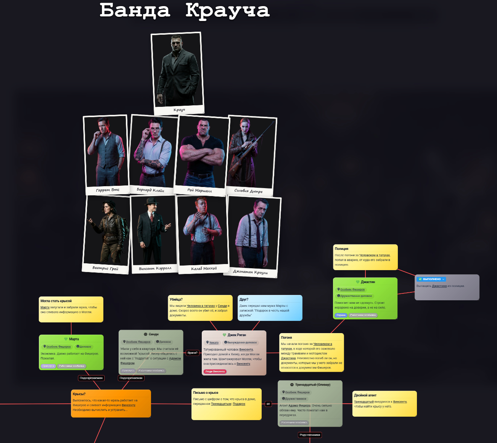
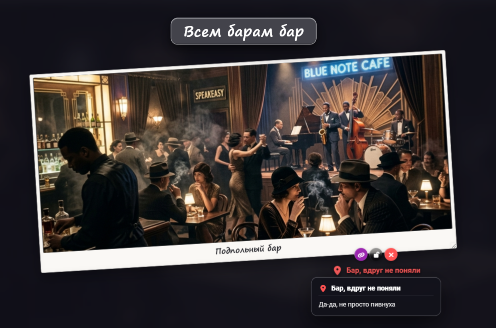
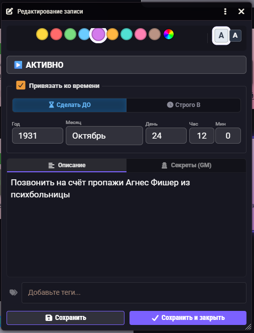
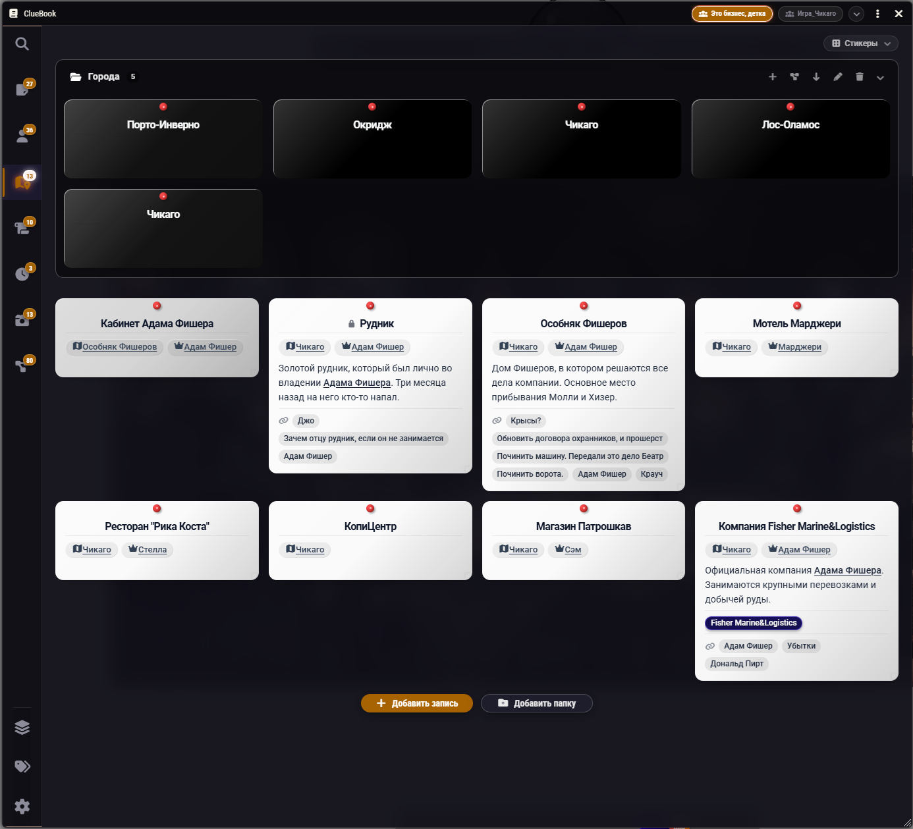
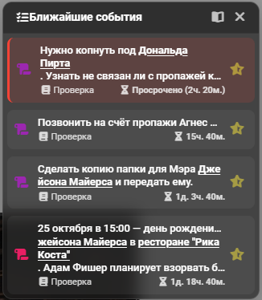
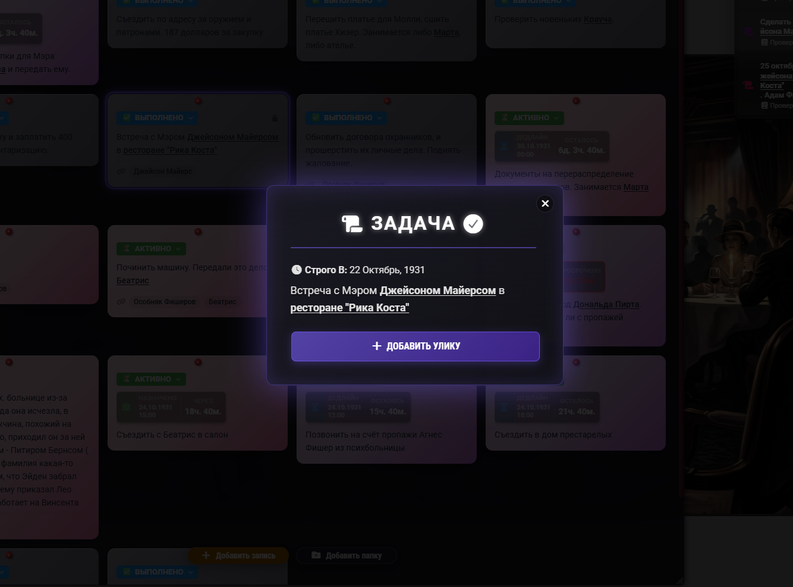
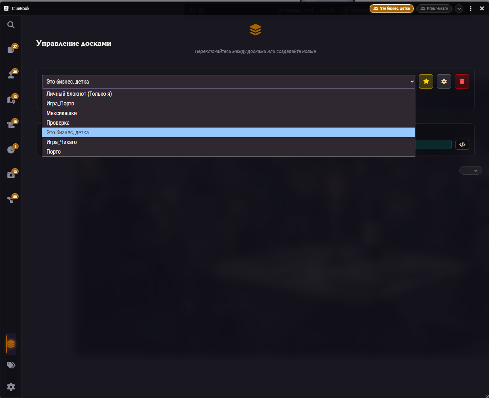
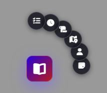

# 🕵️ ClueBook

[](https://github.com/MigaSu/ClueBook/releases)
[](https://github.com/MigaSu/ClueBook/releases)
[](https://foundryvtt.com)

*Читать на [Русском](README_RU.md)*

**ClueBook** is a comprehensive investigation, note-taking, and quest management module for Foundry VTT. It brings together an interactive investigation board (detective whiteboard) with thread connections, dedicated catalogs for notes, NPCs, and locations, an in-game deadline tracker, and multi-workspace support for personal and shared party boards.

Built from the ground up for **Foundry VTT v14** (ApplicationV2, DataModel, native DOM, zero canvas overhead during interactions).

---

## 📋 Table of Contents
1. [Interactive Detective Whiteboard](#1-interactive-detective-whiteboard)
2. [Card Categories & Data Fields](#2-card-categories--data-fields)
3. [View Modes & Folder Organization](#3-view-modes--folder-organization)
4. [Task Tracker & Calendar Integration](#4-task-tracker--calendar-integration)
5. [Workspaces & Permission Management](#5-workspaces--permission-management)
6. [Quick Access, Widgets & Integrations](#6-quick-access-widgets--integrations)
7. [Artificial Intelligence Integration (AI / JSON)](#7-artificial-intelligence-integration-ai--json)
8. [Installation](#installation)

---

## 1. Interactive Detective Whiteboard

An interactive canvas designed to visually map connections between clues, suspects, locations, and events.

* **Visual Thread Connections:**
  * Connect cards by dragging from the link button or clicking two cards in sequence.
  * Double-click any connection line to customize: solid, dashed, or dotted style; custom line color; and text labels (e.g. *"Suspect"*, *"Crime Scene"*, *"Witness"*).
  * Instant link deletion by clicking on the connection badge.
* **Graphics & Photo Cards:**
  * **Clipboard Paste (`Ctrl + V`):** Paste images or screenshots directly onto the board under your cursor.
  * **Batch File Drop:** Drag & drop multiple image files from your desktop to fan them out across the canvas.
  * **Authentic Polaroid Style:** Realistic automatic photo card tilt with an option to toggle tilt in settings.
  * **Image Cropping:** Select image fit mode (*contain* / *cover*) and focal point (*center*, *top*, *bottom*).
* **Pins & Canvas Labels:**
  * **Instant Pins (`Alt + Click`):** Drop colored map pins with selectable icons (skull, marker, question mark, star, fire, etc.). Hovering over a pin reveals a rich popover card with notes and links.
  * **Canvas Labels:** Place stylized typography headers anywhere on the canvas with font choices (*Caveat*, *Inter*, *Courier*, *Cinzel*), pixel size, text color, and background styles (glass, solid, transparent).
* **Board Navigation & Controls:**
  * Smooth zoom (0.1x to 3.0x) centered on cursor position.
  * Middle-click drag or canvas drag for fast panning.
  * One-click camera recenter button fitting all cards within view.
  * Per-workspace camera position persistence.
  * **Lasso Selection:** Click and drag on empty canvas to box-select multiple cards.
  * **Group Context Menu:** Align left/center/right, distribute vertically, reset photo rotation, mass-pin, and mass-delete.
  * **Pin-Lock:** Lock cards in place to prevent accidental dragging or deletion.




---

## 2. Card Categories & Data Fields

Each entry type is tailored for its specific tabletop role:

* **📝 Notes:** Title, rich HTML text editor, color swatches, tags, secret GM notes.
* **🎭 Characters (NPC):** Name, life status (*Alive* / *Dead* / *Unknown*), location, attitude (*Friendly*, *Hostile*, *Neutral*), Foundry Actor linking (drag & drop an Actor to link sheet with one-click sheet opening).
* **🗺️ Locations:** Name, region/subtitle, owner or key NPC, Foundry Scene linking (drag & drop a Scene with one-click scene activation or GM preview).
* **📜 Quests:** Objective text, current status (*Active*, *Completed*, *Failed*), deadline mode (*"By date"* / *"Strictly at"*), calendar timestamp linking, completion timestamp tracking.
* **⏳ Timeline:** Event description, start date/time, end date/time (or duration in days, hours, minutes).
* **📸 Gallery:** Image attachment, caption, polaroid vs frameless toggle, full-screen lightbox viewer.
* **🔍 Full-Text Search:** Instant debounced text search, interactive tag filters, and clickable category chips with match count badges.



---

## 3. View Modes & Folder Organization

Three alternative view modes to handle large volumes of campaign data:

1. **Grid View:** Traditional sticky note cards with quick-action toolbars.
2. **Compact View:** Clean single-line table with category icons, title, status badges, time indicators, and tags.
3. **List View:** Detailed two-line list view displaying text snippets.

*View mode preferences are saved independently per tab.*

### Folders & Sections:
* Create colored folders to group related entries (e.g. *"Docks Suspects"*, *"Manor Clues"*).
* Position folders at the top or bottom of the list.
* Collapsible folder headers with saved state.
* Drag-and-drop cards between folders and the root level.
* **"Send Folder to Board"** button to deploy all folder contents onto the active whiteboard in one click.

### Status Filters & Sorting:
* NPC status filters: `[ All | 💚 Alive | 💀 Dead | ❓ Unknown ]`.
* Quest status filters: `[ All | ⏳ Active | ✅ Completed | ❌ Failed ]`.
* Chronological sorting: earliest first, latest first, or manual drag-and-drop order.



---

## 4. Task Tracker & Calendar Integration

* **On-Screen Task Tracker (`TrackerWidget`):**
  * A lightweight, movable floating widget on the Foundry canvas for GMs and players.
  * Aggregates tracked quests and timeline events from all accessible workspaces.
  * Live countdown: calculates time remaining to deadlines (*"1d 4h 20m remaining"*).
  * Overdue warning indicators with red highlight.
  * Clicking an entry in the widget immediately opens ClueBook and highlights the target card.
  * Clicking the text snippet expands the full description directly inside the widget.
* **Calendar Module Support:**
  * Full integration with **Simple Calendar**, **Calendaria**, and Foundry native world time (`worldTime`).
  * Built-in modal date & time picker for precise year, month, day, hour, and minute selection.
  * Automatically creates synced calendar notes in Simple Calendar and Calendaria when scheduling events.



---

## 5. Workspaces & Permission Management

ClueBook provides strict data separation between players and Game Masters:

* **Personal Notebook:** Every player has an isolated, private notebook stored in user flags. Only the owner and the GM have access.
* **Shared Investigation Boards:** GMs can create unlimited shared campaign boards stored as `JournalEntry` documents inside the *"ClueBook Boards"* folder.
* **Permission Controls:**
  * **Read-Only Mode:** GMs can restrict players to view-only mode on shared boards.
  * **Granular Card Visibility:** Make individual cards visible to specific players or hide them entirely.
  * **Secret GM Notes (`gmNotes`):** Dedicated editor tab for private GM notes, visible only to the GM.
* **3D Clue Broadcast Overlay:**
  * GMs can broadcast any clue card directly to players' screens as a centered 3D presentation card.
  * Players can inspect the clue and click *"Add to My ClueBook"* to copy it into their personal notebook.




---

## 6. Quick Access, Widgets & Integrations

* **Floating Action Button (FAB):**
  * Draggable radial menu in the screen corner to quick-add Notes, NPCs, Locations, Quests, and Events in 1 click.
  * Configurable menu direction and custom gradient accent colors.
  * Option to toggle off the FAB widget and embed the launch button directly into the Scene Controls sidebar.
* **`@` Mentions:**
  * Typing `@` inside any note field opens an auto-complete popup of existing entries.
  * Inserts interactive `[[qnmention:ID:Name]]` links that center the board on the linked card upon clicking.
* **Foundry Sidebar Drag & Drop:**
  * Dragging Actors, Items, Journals, or Scenes into card text fields automatically creates enriched `@UUID[...]` links.
* **Tag Management:**
  * Centralized tag manager per workspace with custom colors.
  * Mark tags as *"Secret"* to keep them visible only to the GM.



---

## 7. Artificial Intelligence Integration (AI / JSON)

ClueBook supports two-way structured data interchange:

* **Data Schema Prompt Copy:** Click the schema format button in the workspace manager to copy a pre-formatted prompt detailing ClueBook's JSON schema (including current in-game calendar timestamps).
* **LLM Campaign Generation:** Paste the prompt into ChatGPT, Claude, or any LLM to generate complex mystery webs, suspect lists, or campaign timelines.
* **One-Click JSON Import:** Paste the AI output into ClueBook's import dialog to instantly populate cards, links, dates, and tags.
* **JSON Export:** Full board export to JSON files for backup or cross-world migration.

---

## 🚀 Installation

1. Copy the manifest link:
   ```text
   https://github.com/MigaSu/ClueBook/releases/latest/download/module.json
   ```
2. In Foundry VTT, go to the **Add-on Modules** tab and click **Install Module**.
3. Paste the link into the **Manifest URL** field and click **Install**.

---

## 💬 Community & Feedback
* 🐛 Issue Tracker & Feature Requests: [GitHub Discussions](https://github.com/MigaSu/ClueBook/discussions)
* ☕ Support Development: [Boosty](https://boosty.to/migasu)
