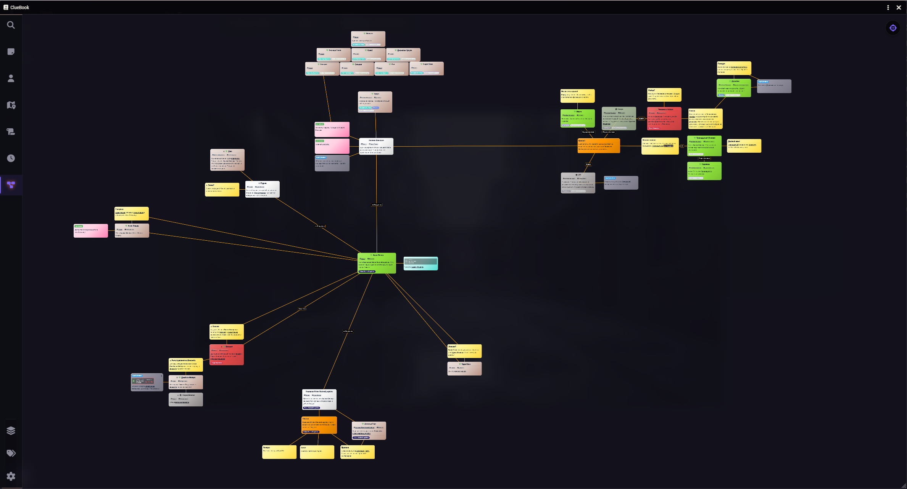

[](https://github.com/MigaSu/ClueBook/releases)
[](https://github.com/MigaSu/ClueBook/releases)
[](https://foundryvtt.com)
[](https://boosty.to/migasu)

**Manifest URL:** `https://github.com/MigaSu/ClueBook/releases/latest/download/module.json`

# 🕵️ ClueBook



*Read this in [English](README.md)*

**ClueBook** — комплексный модуль для ведения расследований, заметок и квест-менеджмента в Foundry VTT. Модуль объединяет в себе интерактивную доску со связями (детективную доску), каталоги заметок, персонажей и локаций, трекер дедлайнов с привязкой к игровому времени, а также систему разделения личных и общих рабочих пространств.

Полностью адаптирован под архитектуру **Foundry VTT v14** (ApplicationV2, DataModel, нативный DOM, нулевая нагрузка на canvas при перетаскивании).

---

## 📋 Содержание
1. [Интерактивная доска расследования (Whiteboard)](#1-интерактивная-доска-расследования-whiteboard)
2. [Категории записей и поля карточек](#2-категории-записей-и-поля-карточек)
3. [Режимы отображения и система папок](#3-режимы-отображения-и-система-папок)
4. [Трекер задач и календарная интеграция](#4-трекер-задач-и-календарная-интеграция)
5. [Рабочие пространства и права доступа](#5-рабочие-пространства-и-права-доступа)
6. [Быстрый доступ, виджеты и интеграции](#6-быстрый-доступ-виджеты-и-интеграции)
7. [Интеграция с искусственным интеллектом (AI / JSON)](#7-интеграция-с-искусственным-интеллектом-ai--json)
8. [Установка](#установка)

---

## 1. Интерактивная доска расследования (Whiteboard)

Интерактивное полотно для визуализации связей между уликами, подозреваемыми и событиями.

* **Визуальные связи:**
  * Соединение карточек протягиванием нити от иконки связи или кликом по двум карточкам.
  * Тонкая настройка линии по двойному клику: сплошная, пунктирная или точечная; выбор индивидуального цвета нити; текстовая подпись (например, *«Подозреваемый»*, *«Место убийства»*, *«Свидетель»*).
  * Быстрое удаление нити по клику на бейдж связи.
* **Графика и фотокарточки:**
  * **Вставка из буфера обмена (`Ctrl + V`):** вставка скопированных изображений или скриншотов прямо на доску в точку под курсором.
  * **Пакетный дроп файлов:** перетаскивание группы картинок с рабочего стола веером раскладывает их по доске.
  * **Полароидный стиль:** реалистичный автоматический наклон фотокарточек с возможностью отключения в настройках.
  * **Кадрирование:** выбор режима отображения фото (*contain* / *cover*) и точки фокуса (*центр*, *верх*, *низ*).
* **Булавки (Пины) и Заголовки:**
  * **Мгновенные пины (`Alt + Клик`):** установка цветных булавок с выбором иконки (череп, метка карты, вопрос, звезда, огонь и др.). При наведении на пин открывается всплывающая карточка (popover) с подробным описанием и ссылками.
  * **Текстовые надписи (Labels):** размещение произвольных заголовков прямо на доске с выбором шрифта (*Caveat*, *Inter*, *Courier*, *Cinzel*), размера в пикселях, цвета текста и фона (стеклянный, сплошной, прозрачный).
* **Навигация и управление:**
  * Плавный зум (0.1x – 3.0x) с центрированием на курсоре.
  * Панорамирование зажатием колесика мыши или перетаскиванием пустого фона.
  * Кнопка быстрой центровки камеры по всем карточкам.
  * Сохранение координат камеры индивидуально для каждого рабочего пространства.
  * **Рамочное выделение (Лассо):** выделение группы карточек зажатием ЛКМ.
  * **Контекстное меню группы:** выравнивание по левому/правому краю или центру, вертикальное распределение, сброс угла наклона, групповое закрепление/удаление.
  * **Блокировка (Pin-lock):** закрепление карточек от случайного перемещения или удаления.


---

## 2. Категории записей и поля карточек

Каждая сущность в ClueBook оптимизирована под свою игровую роль:

* **📝 Заметки (Notes):** Название, форматированный текст (HTML/Journal Editor), цветовая маркировка, теги, скрытые мастерские заметки.
* **🎭 Персонажи (NPC):** Имя, статус жизни (*Жив* / *Мертв* / *Неизвестно*), локация, отношение к партии (*Союзник*, *Враг*, *Нейтрален*), прямая привязка к Актеру Foundry (перетаскивание Actor на карточку с кнопкой быстрого открытия листа персонажа).
* **🗺️ Локации (Locations):** Название, регион/подзаголовок, владелец или ключевой персонаж, привязка к Сцене Foundry (дроп Scene с кнопками активации сцены для всех или предпросмотра для GM).
* **📜 Задания (Quests):** Текст задачи, текущий статус (*В процессе*, *Выполнено*, *Провалено*), тип дедлайна (*«К сроку»* / *«Строго в момент»*), привязка к дате календаря, фиксация времени фактического выполнения.
* **⏳ Хронология (Timeline):** Описание события, дата/время начала, дата/время окончания (или длительность в днях, часах и минутах).
* **📸 Галерея (Gallery):** Изображение, заголовок, примечание, переключение между поляроидным и безрамочным видом, полноэкранный просмотр в лайтбоксе.
* **🔍 Полнотекстовый поиск (Search):** Мгновенная фильтрация по тексту карточек, интерактивные фильтры по тегам и кликабельные чипы категорий с индикацией количества совпадений.


---

## 3. Режимы отображения и система папок

Для работы с большими объемами информации предусмотрено 3 альтернативных режима отображения списков:

1. **Сетка (Grid View):** Цветные карточки-стикеры с кнопками управления.
2. **Компактная таблица (Compact View):** Однострочный вид карточки со значком категории, названием, статусом, бейджем времени и тегами.
3. **Подробный список (List View):** Двухстрочный вид с показом начала текста (сниппета).

*Режим отображения сохраняется индивидуально для каждой вкладки.*

### Папки и секции:
* Создание папок для группировки записей (например, *«Подозреваемые в порту»*, *«Улики из поместья»*).
* Настройка цвета папки и положения (сверху или снизу списка).
* Сворачивание и разворачивание секций с сохранением состояния.
* Перемещение карточек между папками и корнем через Drag-and-Drop.
* Кнопка «Отправить всю папку на доску» — переносит все записи папки на активную доску в один клик.

### Фильтры и сортировка:
* Быстрые фильтры NPC по статусу: `[ Все | 💚 Живые | 💀 Мертвые | ❓ Неизвестно ]`.
* Быстрые фильтры квестов: `[ Все | ⏳ Активные | ✅ Выполненные | ❌ Проваленные ]`.
* Сортировка квестов и событий: по возрастанию даты, по убыванию даты или ручной порядок.


---

## 4. Трекер задач и календарная интеграция

* **Плавающий экранный виджет (`TrackerWidget`):**
  * Компактная панель поверх интерфейса Foundry, доступная игрокам и мастеру.
  * Отображает отслеживаемые задачи и события со всех доступных игроку блокнотов.
  * Динамический расчет времени: показывает точный обратный отсчет до дедлайна (*«Осталось: 1д 4ч 20м»*).
  * Автоматическая индикация просроченных задач красным цветом.
  * Клик по задаче в виджете мгновенно открывает ClueBook и подсвечивает карточку анимацией.
  * Клик по тексту задачи разворачивает полное описание прямо внутри виджета.
* **Календарные провайдеры:**
  * Полная совместимость с модулями **Simple Calendar**, **Calendaria** и нативным игровым временем Foundry (`worldTime`).
  * Встроенный модальный календарный пикер для точного выбора года, месяца, дня, часа и минут.
  * Автоматическое создание заметок в календаре Simple Calendar / Calendaria при создании датированных событий.


---

## 5. Рабочие пространства и права доступа

ClueBook разграничивает информацию между игроками и ведущим:

* **Личный блокнот (Personal):** У каждого игрока есть собственное изолированное пространство, сохраняемое в флагах пользователя. Записи личного блокнота видит только сам игрок и GM.
* **Общие доски расследования (Shared Workspaces):** Мастер может создавать неограниченное число общих досок. Они хранятся в специальных журналах `JournalEntry` в папке *"ClueBook Boards"*.
* **Разграничение доступа:**
  * Режим *«Только для чтения»* — игроки могут просматривать общую доску, но не могут удалять или изменять карточки.
  * Индивидуальная видимость — возможность показать карточку только выбранным игрокам или скрыть её ото всех.
  * **Секретные мастерские заметки (`gmNotes`):** Отдельная вкладка в редакторе карточки, доступная исключительно ведущему.
* **3D-Трансляция улик (Overlay):**
  * Ведущий может нажать кнопку трансляции на карточке — она плавно появится в центре экранов игроков в виде 3D-карточки.
  * Игроки могут изучить улику и нажать кнопку *«Добавить в свой блокнот»* для копирования записи в личные заметки.


---

## 6. Быстрый доступ, виджеты и интеграции

* **Плавающая кнопка быстрого добавления (FAB):**
  * Круглое радиальное меню в углу экрана для добавления заметок, NPC, локаций, квестов и событий в 1 клик.
  * Свободное перетаскивание кнопки по экрану, выбор направления раскрытия меню, настройка градиента цветов.
  * Возможность отключить виджет и перенести вызов модуля в панель инструментов сцены (Scene Controls).
* **Умные упоминания (`@` Mentions):**
  * При вводе `@` в любом текстовом поле открывается автодополнение по существующим записям.
  * Создает интерактивную ссылку `[[qnmention:ID:Name]]`, клик по которой центрирует камеру на связанной карточке или открывает её в блокноте.
* **Drag & Drop из боковой панели Foundry:**
  * Перетаскивание актеров, предметов, журналов и сцен в редактор автоматически генерирует валидные `@UUID[...]` ссылки с обогащением текста.
* **Менеджер тегов:**
  * Централизованное управление тегами для каждого рабочего пространства.
  * Цветовая кодировка тегов и возможность пометить тег как *«Секретный»* (будет виден только мастеру).


---

## 7. Интеграция с искусственным интеллектом (AI / JSON)

ClueBook поддерживает двусторонний обмен данными через структурированный JSON:

* **Копирование промпта структуры данных:** кнопка в менеджере досок копирует системную инструкцию с описанием JSON-схемы модуля (включая текущую игровую дату и временную дельту календаря).
* **Генерация через LLM:** вставьте скопированный промпт в ChatGPT, Claude или любую другую языковую модель с запросом на генерацию детективного расследования, списка зацепок или NPC.
* **Импорт в 1 клик:** вставьте ответ нейросети в окно импорта ClueBook — все карточки, статусы, даты и теги мгновенно появятся на доске.
* **Экспорт:** полное сохранение структуры доски в файл для бекапа или переноса в другой мир.

---

## 🚀 Установка

1. Скопируйте ссылку на файл манифеста:
   ```text
   https://github.com/MigaSu/ClueBook/releases/latest/download/module.json
   ```
2. В Foundry VTT перейдите во вкладку **Add-on Modules** и нажмите **Install Module**.
3. Вставьте ссылку в поле **Manifest URL** и нажмите **Install**.

---

## 💬 Обратная связь и разработка
* 🐛 Отчёты об ошибках и предложения: [GitHub Discussions](https://github.com/MigaSu/ClueBook/discussions)
* ☕ Поддержать разработку модуля: [Boosty](https://boosty.to/migasu)
